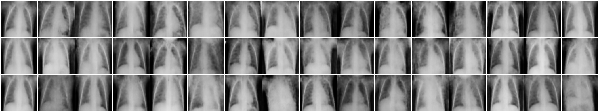

# HW1: Generating Chest X-Rays with a Variational Autoencoder

A convolutional VAE trained on the PNEUMONIA class of the
[Kaggle chest X-ray dataset](https://www.kaggle.com/paultimothymooney/chest-xray-pneumonia)
and evaluated with FID and Inception Score using
[PyTorch-Ignite](https://pytorch-ignite.ai/blog/gan-evaluation-with-fid-and-is/).
Full write-up: [`report/vae_report.pdf`](report/vae_report.pdf).



## Results

Each set has 390 images, compared against the 390 held-out PNEUMONIA test X-rays (mean ± std over 5 draws).

| Image set | FID ↓ | IS ↑ |
|---|---|---|
| Real training images (floor) | 0.008 ± 0.001 | 2.13 ± 0.07 |
| VAE reconstructions | 0.206 ± 0.007 | 1.87 ± 0.03 |
| **VAE samples** | **0.163 ± 0.006** | **1.74 ± 0.03** |

Ignite's pipeline feeds `[0,1]` images to torchvision's InceptionV3, so absolute FIDs are small
(the Ignite tutorial reports ≈0.016 for a DCGAN on CelebA). Use the real-image floor as the reference.

## Reproduce

```bash
pip install -r requirements.txt
# Download and unzip the Kaggle dataset so that chest_xray/{train,val,test}/{NORMAL,PNEUMONIA}/ exists here
python train.py      # ~4 min on an RTX 5060 laptop GPU -> results/vae.pt, loss_history.json
python evaluate.py   # figures + results/metrics.json
cd report && latexmk -pdf vae_report.tex
```

All hyperparameters live in [`config.py`](config.py). Set `TRAINING_CLASS = "NORMAL"` to train on the other class.

| File | Purpose |
|---|---|
| `config.py` | Paths and hyperparameters |
| `data.py` | Decodes, resizes and caches the images; filters to one class |
| `model.py` | Conv VAE and ELBO terms |
| `train.py` | Training with KL warm-up and cosine LR; logs loss curves |
| `evaluate.py` | Sampling, reconstructions, Ignite FID / IS |
| `visualize.py` | Loss-curve and image-grid figures |
